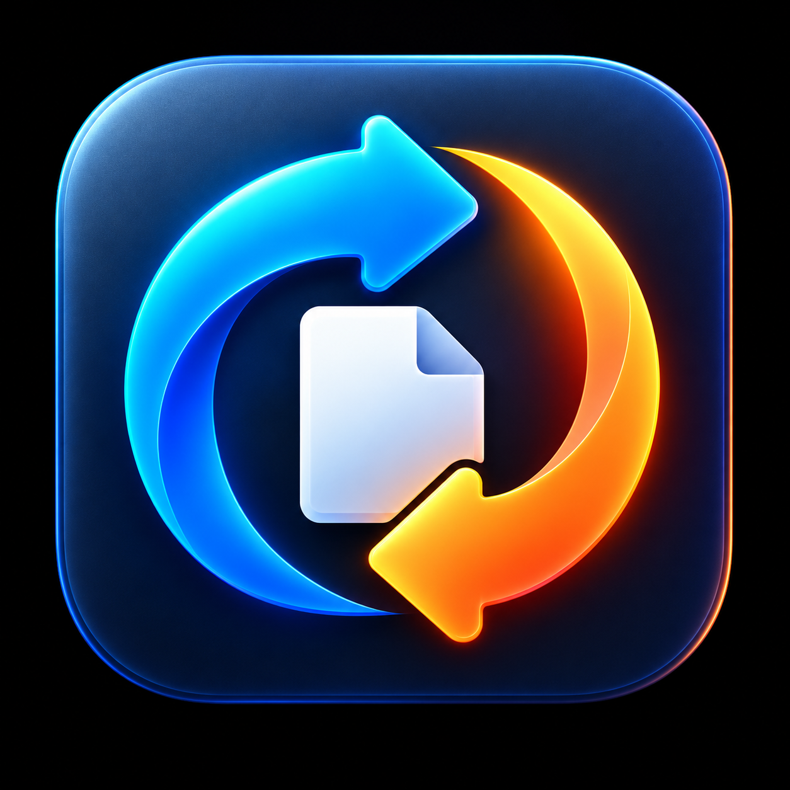
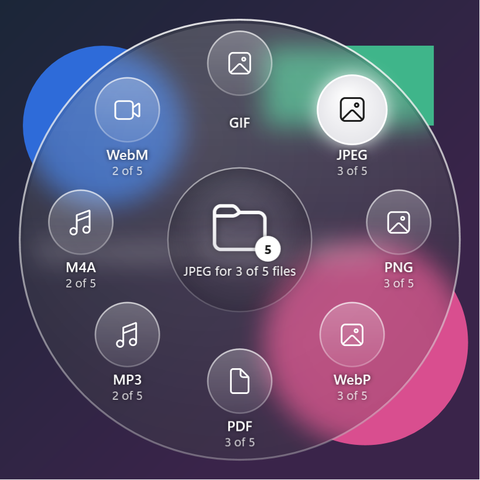
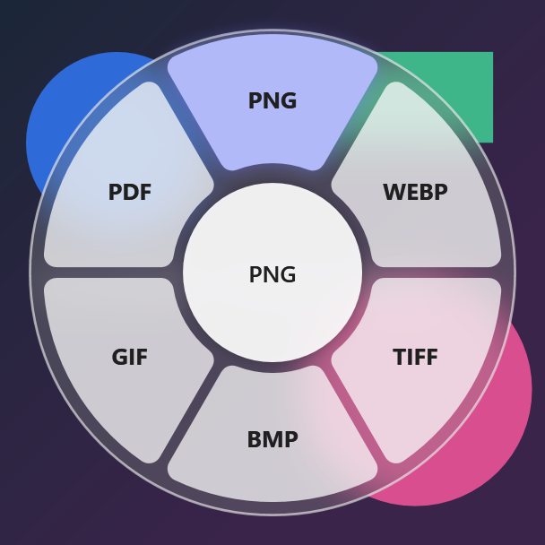
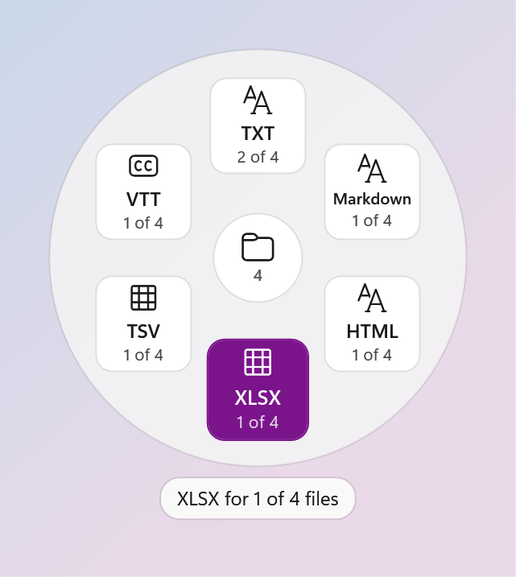
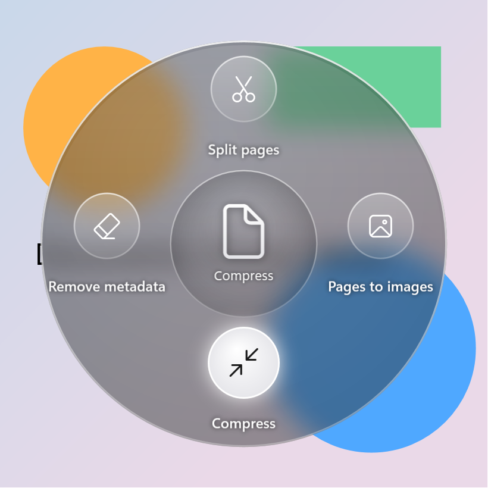

<div align="center">



# DragConvert

**Convert files mid-drag, on Windows.** Start dragging a file, hold <kbd>Ctrl</kbd>+<kbd>Shift</kbd>, and drop it on the format you want.

[](https://github.com/Paulodemoc/DragConvert/actions/workflows/ci.yml)
[](https://github.com/Paulodemoc/DragConvert/releases)


[](LICENSE)



</div>

DragConvert lives in the system tray. While you drag files anywhere (Explorer, the desktop, a browser's download
bar), holding the trigger keys opens a dial of the formats those files can become. Drop on a tile and a converted
copy appears next to the original. No window to open, no upload, no account: everything runs on your PC and the
original file is never touched.

## Features

- **Drag-to-convert overlay.** Only the formats that make sense for what you're dragging are shown. Mixed
  selections show how many files each format applies to ("JPEG · 3 of 5"); folders are expanded recursively.
- **Quick tools.** Press <kbd>Alt</kbd> while the dial is open to swap formats for tools: compress, merge or split
  PDFs, remove metadata, extract archives and more.
- **Other ways in.** Drop files on the tray window, or use **Send to → DragConvert** in Explorer's context menu.
- **Safe by design.** Output is written to a temporary file and renamed into place; existing files are never
  overwritten; a crash leaves no half-written files behind.
- **Light on resources.** Idle at 0% CPU and a few MB of working set; the mouse hook steps aside for fullscreen
  apps, games and remote-desktop sessions.
- **Three overlay styles**, switchable live in Settings, following Windows' light, dark and high-contrast themes:

<div align="center">
&nbsp;
&nbsp;

<br><sub>Segments · Ring · Tools (Alt) on a PDF</sub>
</div>

## What it converts

| From | To |
| --- | --- |
| **Images**: JPEG, PNG, WebP, AVIF, HEIC, TIFF, BMP, GIF, SVG | JPEG, PNG, WebP, AVIF, TIFF, BMP, GIF, PDF |
| **Audio**: WAV, MP3, M4A, FLAC, OGG, Opus, AIFF, WMA | MP3, M4A, FLAC, OGG, Opus, WAV, AIFF, WMA |
| **Video**: MP4, MOV, MKV, WebM, AVI, WMV | MP4, MOV, MKV, WebM, AVI, WMV, GIF, MP3, M4A |
| **Documents**: PDF, Word (DOCX), Markdown | TXT, Markdown, HTML |
| **Spreadsheets**: CSV, TSV, Excel (XLSX) | CSV, TSV, XLSX |
| **Subtitles**: SRT, VTT | SRT, VTT, TXT |

HEIC is read-only; animated GIFs can also become MP4 or WebM. Text from documents keeps headings, emphasis, links, lists and tables, not the page layout.

### Tools (hold <kbd>Alt</kbd>)

| Files | Tools |
| --- | --- |
| PDF | Compress · Merge · Split pages · Pages to PNG / JPG · Remove metadata |
| Images | Compress · Combine into one PDF · Remove metadata |
| Audio | Compress · Normalize loudness · Make mono · Waveform image · Remove metadata |
| Video | Compress · Mute · Snapshot · Remove metadata |
| Archives (ZIP, TAR, GZ/TGZ, RAR, 7z) | Extract |
| Anything | Zip |

Compress is offered for lossy formats (JPEG, PNG, TIFF, AVIF; MP3, M4A, OGG, Opus, WMA; MP4, MOV, MKV, WebM).

## Install

1. Download `DragConvert-<version>-win-x64.zip` from [Releases](https://github.com/Paulodemoc/DragConvert/releases).
2. Unzip it anywhere (for example `%LOCALAPPDATA%\Programs\DragConvert`) and run `DragConvert.exe`.
   No .NET install is needed.
3. Optional: in Settings (tray icon → right-click), turn on **Start with Windows**.

> [!NOTE]
> Early builds aren't code-signed yet, so Windows SmartScreen may warn on first run: choose **More info → Run
> anyway**. Each release lists the zip's SHA-256 so you can check the download.

> [!IMPORTANT]
> Don't run DragConvert as administrator: Windows blocks drag-and-drop from normal apps (like Explorer) into
> elevated ones.

## Usage

1. Start dragging one or more files.
2. While dragging, hold <kbd>Ctrl</kbd>+<kbd>Shift</kbd> (configurable). The dial opens under the cursor.
3. Optionally press <kbd>Alt</kbd> to switch between formats and tools.
4. Drop on a tile. A notification tells you when it's done. To cancel, release the keys before you drop: the drag
   carries on as a normal one.

Converted files go beside the originals (`holiday.heic` → `holiday.jpg`), or into one folder of your choice.

## Privacy

DragConvert makes **no network connections** and collects no telemetry. Conversions run in-process or through the
bundled FFmpeg, on your machine. Logs stay in `%LOCALAPPDATA%\DragConvert\logs`.

## Building from source

Requirements: Windows 10 2004+ and the [.NET 10 SDK](https://dotnet.microsoft.com/download) (version pinned in
`global.json`).

```powershell
git clone https://github.com/Paulodemoc/DragConvert.git
cd DragConvert
pwsh tools/fetch-ffmpeg.ps1          # LGPL FFmpeg into tools/bin (for audio/video and tests)
dotnet build DragConvert.slnx
dotnet test DragConvert.slnx
dotnet run --project src/DragConvert.App
```

Useful developer commands:

| Command | What it does |
| --- | --- |
| `DragConvert.exe --gallery` | Every overlay state, live, in one window |
| `DragConvert.exe --snapshot` | Renders those states to PNG in `artifacts/ui` |
| `DragConvert.exe --smoke` | Starts, converts a tiny image and exits (used by CI) |
| `dotnet run --project src/DragConvert.Cli -- formats <file>` | Lists targets and tools for a file |
| `dotnet run --project src/DragConvert.Cli -- convert <file>... <format>` | Converts without the UI |
| `pwsh tools/package.ps1 -Version 0.1.0` | Builds the portable release zip |

### Project layout

| Project | Role |
| --- | --- |
| `DragConvert.Core` | Formats, catalog, job queue, tools contract, settings (no UI, no Win32) |
| `DragConvert.Providers` | Converters and tools: Magick.NET, FFmpeg, PDFsharp, PdfPig, Open XML, Markdig, SharpCompress |
| `DragConvert.Providers.Windows` | Providers built on Windows APIs (PDF page rendering) |
| `DragConvert.Native` | Win32: low-level mouse hook, windows, shell integration |
| `DragConvert.App` | WPF tray app, overlay, notifications |
| `DragConvert.Cli` | Command-line harness for testing conversions |

Design and decisions: [docs/design.md](docs/design.md), [docs/decisions](docs/decisions), [docs/roadmap.md](docs/roadmap.md).

### Releasing

Push a tag like `v0.2.0` on `main`. The [Release workflow](.github/workflows/release.yml) builds, tests, packages
the self-contained exe with FFmpeg, smoke-tests the package and publishes a GitHub release with the zip and its
SHA-256. Versions below 1.0 are marked as pre-releases.

## Inspiration

DragConvert was inspired by **Tangerine**, a file converter for macOS
that converts files with a drag-and-drop gesture. DragConvert is an independent Windows project, written from
scratch, and isn't affiliated with or endorsed by Tangerine's authors.

## License

[MIT](LICENSE). DragConvert bundles third-party components under their own licenses, including an LGPL build of
FFmpeg; see [THIRD-PARTY-NOTICES.md](THIRD-PARTY-NOTICES.md).
